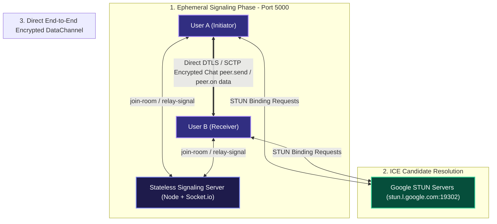
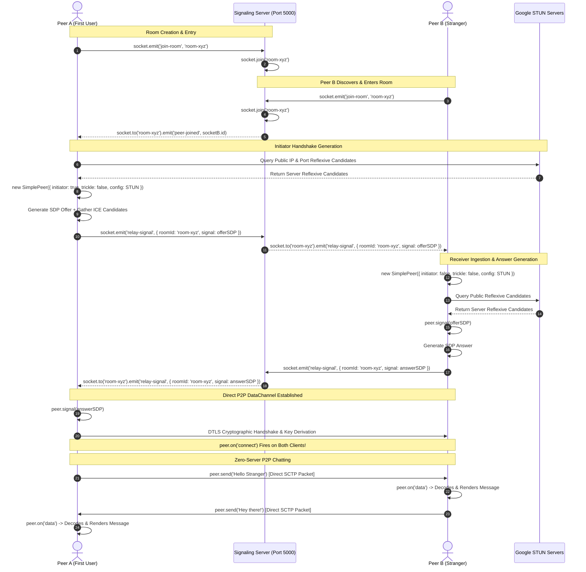

# 🌌 VoidChat (GhostChat)

> **Zero-Knowledge, Ephemeral, True Peer-to-Peer Encrypted Communication Protocol**

[](https://opensource.org/licenses/MIT)
[](https://nodejs.org/)
[](https://react.dev/)
[](https://vitejs.dev/)
[](https://socket.io/)
[](https://webrtc.org/)

---

## 📖 Executive Summary

**VoidChat** is a decentralized, privacy-first ephemeral communication platform. Unlike conventional chat applications that store messages in persistent databases, route encrypted payloads through corporate relay servers, or harvest telemetry, **VoidChat operates on a zero-knowledge, zero-storage paradigm**:

1. **Stateless Signaling**: The central server functions solely as an ephemeral matchmaker to exchange initial WebRTC Session Description Protocol (SDP) signals.
2. **True Peer-to-Peer DataChannels**: Once the initial handshake completes, all communications traverse directly between participants via end-to-end encrypted WebRTC `RTCDataChannel` connections.
3. **No Database & No Logs**: The server contains no database, stores no chat history, logs no IP mappings, and discards all room memberships upon socket disconnection.
4. **Disappearing State**: Refreshing or closing the tab permanently deletes all conversation keys and message histories from client memory.

---

## 🏛️ High-Level System Architecture



### Architectural Separation of Concerns

* **Signaling Plane (`ghost-chat-backend`)**:
  * Facilitates room coordination using lightweight Socket.io rooms.
  * Relays raw WebRTC SDP offers, answers, and ICE candidate packages blindly without inspecting or caching payloads.
  * Completely agnostic to message contents, user identities, or chat state.

* **Data Plane (`ghost-chat-frontend`)**:
  * Negotiates symmetric cryptographic keys via Datagram Transport Layer Security (DTLS).
  * Establishes a bidirectional Stream Control Transmission Protocol (SCTP) DataChannel directly over UDP.
  * Chat messages are piped directly through `peer.send(message)`, completely bypassing the backend server.

---

## 🤝 Signaling & WebRTC Handshake Sequence

The following sequence diagram details the exact protocol lifecycle when two peers join an ephemeral room:



---

## 🔒 Security & Privacy Architecture

### 1. End-to-End Cryptographic Security
* **DTLS (Datagram Transport Layer Security)**: All WebRTC DataChannel traffic is mandatorily encrypted with DTLS (RFC 8261 / RFC 7345). Eavesdropping, tampering, or message interception by third parties on intermediary networks is mathematically prohibited.
* **SCTP over DTLS**: Chat messages travel over an encapsulated SCTP channel authenticated and encrypted with AES-GCM cipher suites negotiated dynamically between peers.

### 2. Zero-Knowledge Stateless Server
* **Zero Database Dependability**: The backend uses no SQLite, PostgreSQL, MongoDB, or Redis instance.
* **No Message Forwarding**: The server codebase possesses zero endpoints or socket events for message transmission (`chat-message` or similar events do not exist).
* **Instant Disconnection Cleanup**: As soon as a client closes their connection, Socket.io garbage-collects the socket identifier from memory.

### 3. STUN Candidate Harvesting & NAT Traversal
* Configured with Google's public STUN servers:
  ```javascript
  const PEER_CONFIG = {
    iceServers: [
      { urls: 'stun:stun.l.google.com:19302' },
      { urls: 'stun:stun1.l.google.com:19302' },
    ],
  };
  ```
* Resolves Session Traversal Utilities for NAT (STUN) candidates, permitting direct communication between peers across Symmetric, Restricted Cone, or Port-Restricted NAT environments without leaking internal enterprise LAN parameters.

### 4. Client-Side Volatility
* Message data resides strictly in volatile React component state (`useState([])`).
* No use of `localStorage`, `sessionStorage`, `IndexedDB`, or cookies.
* Refreshing the browser or clicking **Leave Room** triggers `peer.destroy()`, instantly severing the WebRTC channel and wiping all plaintext messages from RAM.

---

## 🛠️ Technology Stack Breakdown

| Component | Technology | Version | Purpose |
|---|---|---|---|
| **Backend Runtime** | Node.js | `>= 18.x` | High-performance asynchronous event loop |
| **Backend Framework** | Express | `5.3.0` | HTTP infrastructure & health probe endpoints |
| **Signaling Engine** | Socket.io | `4.8.4` | Real-time bidirectional room-based signaling |
| **CORS Middleware** | CORS | `2.8.6` | Cross-origin resource sharing policy enforcement |
| **Frontend Framework** | React | `19.2.8` | Declarative reactive UI components & state hooks |
| **Build Bundler** | Vite | `8.3.4` | Ultra-fast Hot Module Replacement (HMR) & ESBuild bundling |
| **WebRTC Client** | simple-peer | `9.12.0` | Concise WebRTC DataChannel abstraction |
| **Node.js Polyfills** | vite-plugin-node-polyfills | `0.23.0` | Browser shims for `Buffer`, `process`, and `global` |
| **Styling** | Vanilla CSS3 | Standard | Custom cyber-spectral design system with glassmorphism |
| **Typography** | Google Fonts | Web | 'Outfit', 'Inter', and 'JetBrains Mono' |

---

## 📂 Project Directory Structure

```text
VoidChat/
├── .gitignore                      # Root ignore rules for node_modules, dist, logs
├── LICENSE                         # MIT License
├── README.md                       # Comprehensive architectural documentation
├── ghost-chat-backend/             # Stateless WebRTC signaling server
│   ├── package.json                # Dependencies: express, socket.io, cors
│   ├── package-lock.json
│   └── server.js                   # Socket server listening on port 5000
└── ghost-chat-frontend/            # Vite + React 19 WebRTC client application
    ├── index.html                  # HTML5 entry with Google Fonts & SEO metadata
    ├── package.json                # Dependencies: react, simple-peer, socket.io-client
    ├── package-lock.json
    ├── vite.config.js              # Vite configuration with node polyfills
    ├── public/
    │   ├── favicon.svg             # Custom spectral ghost favicon
    │   └── icons.svg
    └── src/
        ├── main.jsx                # React root mount with window.global polyfill
        ├── index.css               # Design tokens, color system, CSS variables
        ├── App.jsx                 # Stateful room join, WebRTC lifecycle, P2P chat
        └── App.css                 # Glassmorphic card styling, message bubbles
```

---

## 🚀 Getting Started & Installation

### Prerequisites
* **Node.js**: `v18.0.0` or higher
* **npm**: `v9.0.0` or higher

---

### Step 1: Clone the Repository
```bash
git clone https://github.com/Souvik-Das-23/VoidChat.git
cd VoidChat
```

---

### Step 2: Start the Signaling Backend

```bash
cd ghost-chat-backend
npm install
npm start
```

*The signaling server will start listening at `http://localhost:5000`.*

---

### Step 3: Start the Frontend Application

In a separate terminal:

```bash
cd ghost-chat-frontend
npm install
npm run dev
```

*The Vite development server will start at `http://localhost:5173`.*

---

## 🧪 Testing Peer-to-Peer Communication

To test end-to-end P2P chat locally:

1. Open your browser to **`http://localhost:5173`** (**Tab 1**).
2. Open a separate browser window or incognito session to **`http://localhost:5173`** (**Tab 2**).
3. In **Tab 1**:
   * Click **✦ Auto-generate** (or input code `aaa111`).
   * Click **Join Room**.
4. In **Tab 2**:
   * Input the exact room code (e.g. `aaa111`).
   * Click **Join Room**.
5. Observe the status badge switch to **`🔒 P2P Encrypted Active`**.
6. Type a message in Tab 1 and hit **Send**:
   * The message is delivered directly via WebRTC DataChannel.
   * Rendered labeled as **"Me"** on Tab 1, and **"Stranger"** on Tab 2.
   * Verify the terminal running `ghost-chat-backend`: **zero chat messages pass through the server**.

---

## 📡 Socket.io Event API Reference

| Event Name | Direction | Payload Schema | Description |
|---|---|---|---|
| `join-room` | Client ➔ Server | `roomId: string` | Registers the socket into the specified room. |
| `peer-joined` | Server ➔ Client | `peerId: string` | Notifies existing room participants that a new peer arrived. |
| `relay-signal` | Client ➔ Server | `{ roomId: string, signal: object }` | Submits SDP offer/answer or ICE candidate for relay. |
| `relay-signal` | Server ➔ Client | `{ roomId: string, signal: object }` | Delivers the relayed WebRTC signal to the target peer. |

---

## 📜 WebRTC SimplePeer Lifecycle API

| Event | Direction | Trigger | Handler Action |
|---|---|---|---|
| `peer.on('signal')` | Internal ➔ Outgoing | Generated SDP Offer/Answer | Dispatches signal to room via `socket.emit('relay-signal')`. |
| `peer.on('connect')` | Incoming | DataChannel successfully opened | Marks `isP2PConnected = true`; enables message input UI. |
| `peer.on('data')` | Incoming | Peer transmitted raw byte payload | Decodes `Uint8Array` to text; updates chat log with `"Stranger"`. |
| `peer.on('close')` | Disconnect | Peer severed connection | Resets peer ref; displays system notice; returns to standby. |
| `peer.on('error')` | Internal | Cryptographic or ICE failure | Logs error diagnostics without leaking sensitive data. |

---

## 📄 License

This project is open-sourced under the terms of the **[MIT License](file:///f:/PROJECT/VoidChat/LICENSE)**.

---

<p align="center">
  Built with 💜 for zero-knowledge, decentralized peer-to-peer privacy.
</p>